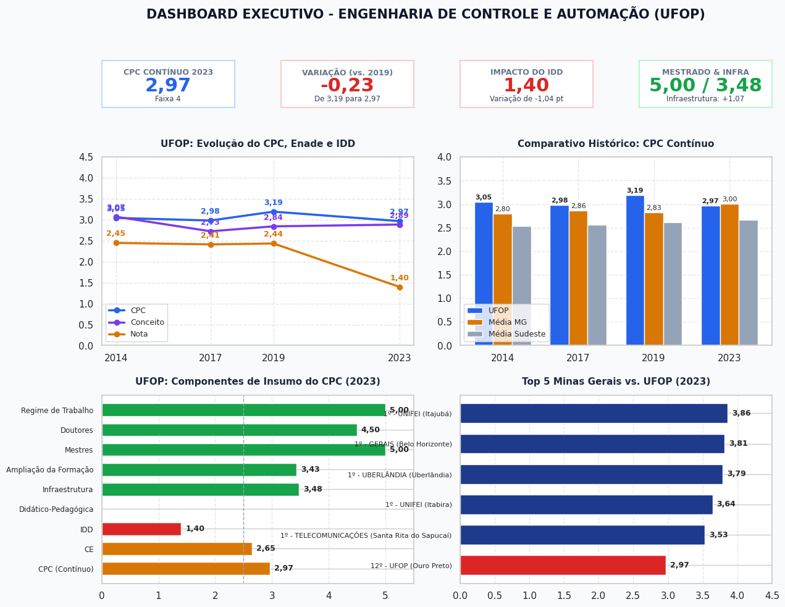

# Análise dos Indicadores Acadêmicos: Engenharia de Controle e Automação (Escola de Minas - UFOP)



## Sobre o Projeto
Projeto desenvolvido como ação voluntária de extensão e iniciativa estudantil (**Pró-Ativa**) na **Escola de Minas da Universidade Federal de Ouro Preto (UFOP)** — Campus Morro do Cruzeiro. 

O objetivo deste estudo é analisar a evolução histórica do desempenho do curso de **Engenharia de Controle e Automação (Código INEP: 5814)** nos ciclos avaliativos de **2014, 2017, 2019 e 2023**, comparando os resultados da UFOP com outras Instituições de Ensino Superior (IES) de Minas Gerais (públicas e privadas) e da Região Sudeste.

###  Indicadores Analisados:
* **Conceito ENADE:** Desempenho dos estudantes concluintes na prova específica e de formação geral.
* **IDD (Indicador de Diferença entre os Desempenhos Observado e Esperado):** Mede o valor agregado pelo curso ao comparar a nota de entrada (ENEM) com a nota de saída (ENADE).
* **CPC (Conceito Preliminar de Curso):** Indicador composto que reúne nota do ENADE, IDD, titulação e regime do corpo docente (mestres e doutores), infraestrutura e organização didático-pedagógica.
* **IGC (Índice Geral de Cursos):** Avaliação global da qualidade da instituição de ensino.

## Contextualização Histórica (INEP e SINAES)
O processo de industrialização brasileira, a partir da década de 1930, demandou mão de obra com maior qualificação educacional. Com o objetivo de subsidiar a formulação de políticas públicas por meio de estudos sobre os problemas do ensino nacional, foi criado, em 1937 (Lei nº 378), o Instituto Nacional de Pedagogia, posteriormente denominado **Instituto Nacional de Estudos e Pesquisas Educacionais Anísio Teixeira (INEP)** (BRASIL, 1937). 

Em 1952, o educador Anísio Teixeira assumiu a direção do INEP, buscando transformá-lo em centro de referência para o magistério nacional e polo de articulação do sistema educacional brasileiro (Mendonça, 2005). Com a promulgação da primeira Lei de Diretrizes e Bases da Educação Nacional (Lei nº 4.024/1961), consolidaram-se os levantamentos sistemáticos sobre a educação no país. Aplicado desde 2004 pelo INEP, o **ENADE** integra o **SINAES** (Sistema Nacional de Avaliação da Educação Superior), cujos microdados e planilhas públicas fundamentam esta pesquisa (Bittencourt et al., 2009; Lima et al., 2019).

---

## Tecnologias e Bibliotecas Utilizadas
* **Linguagem:** Python 3
* **Ambiente de Desenvolvimento:** Google Colab
* **Manipulação e Tratamento de Dados:** `pandas`, `numpy`, `openpyxl`
* **Visualização de Dados e Dashboard:** `matplotlib` (GridSpec), `seaborn`, `plotly`

---

## Metodologia e Pipeline de Dados
1. **Extração e Leitura Inteligente:** Carregamento automatizado das planilhas oficiais do INEP (`CPC`, `IGC`, `IDD` e `Conceito_Enade`) para os anos de 2014, 2017, 2019 e 2023, identificando dinamicamente as abas de dados e padronizando nomenclaturas de colunas que variam entre os ciclos.
2. **Filtragem Geográfica e de Curso:** Isolamento dos registros referentes ao curso de Engenharia de Controle e Automação na Região Sudeste (`SP`, `MG`, `RJ`, `ES`), com recorte específico para o estado de Minas Gerais e para a UFOP.
3. **Decomposição de Insumos:** Extração e normalização (escala 0 a 5) dos subcomponentes do CPC (Infraestrutura, Organização Didático-Pedagógica, Mestres, Doutores, Regime de Trabalho, IDD e Nota Bruta).
4. **Benchmarks e Rankings:** Comparação temporal da UFOP frente à média das Universidades Federais de MG, média estadual, média do Sudeste e o Top 5 estadual de 2023.
5. **Geração de Entregáveis:** Exportação automática de planilha consolidada multi-abas (`outputs/resumo_analise_ufop.xlsx`) e geração de Dashboard Executivo em alta definição (`outputs/dashboard_automacao.png`).

---

## Estrutura do Repositório
```text
analise-enade-eca-ufop/
├── data/               # Planilhas públicas do INEP (organizadas por ciclo avaliativo)
├── notebooks/          # Código-fonte completo em Jupyter Notebook / Google Colab
├── outputs/            # Dashboard executivo (.png) e relatório consolidado (.xlsx)
├── requirements.txt    # Dependências do projeto em Python
└── README.md           # Documentação do projeto
